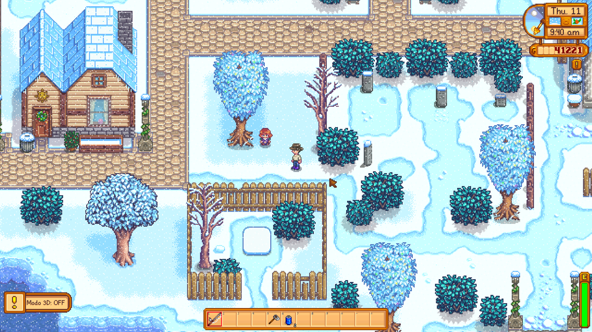
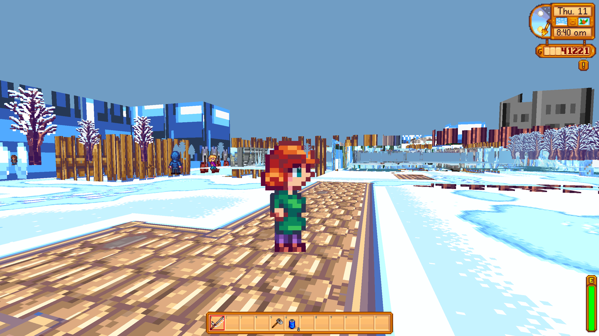

# Stardew Valley 3D

Mod que transforma **Stardew Valley 1.6** em um jogo **3D em primeira pessoa** no qual os
sprites 2D originais são **extrudados em volumes**, na linha de Doom e Warhammer 40k: Boltgun —
mantendo **toda a lógica original do jogo** intacta e adaptando apenas a apresentação e a mira
para o espaço 3D.

| Vanilla (`Modo 3D: OFF`) | Mod ligado |
|---|---|
|  |  |

As duas capturas são do mesmo save, no mesmo dia de inverno, alternadas com `F9`. À direita,
cada árvore, cerca, lixeira e NPC é o **mesmo sprite 2D do jogo**, convertido em um volume com
espessura e desenhado numa cena 3D — nada foi redesenhado nem substituído por modelo.

---

## O objetivo

Jogar Stardew Valley inteiro de dentro do mundo, em primeira pessoa, sem perder nada do jogo:

- **Nenhuma mecânica reescrita.** Tempo, cultivos, NPCs, amizade, economia, combate, pesca,
  mina e save continuam sendo o código original da ConcernedApe. O mod intercepta o *desenho*
  e a *mira*, não as regras.
- **Nenhum asset novo.** Tudo o que existe em 2D deve aparecer em 3D sem ser alterado nem
  bugado — os sprites do jogo (e dos mods de textura que você já usa) são a fonte.
- **Compatibilidade com save.** O mod pode ser ligado e desligado a qualquer momento (`F9`) no
  meio de uma partida; desligado, o jogo volta a ser exatamente o vanilla.

O escopo completo, dividido em 9 fases, está em **[docs/SCOPE.md](docs/SCOPE.md)**.
As decisões técnicas e o que foi descoberto lendo a IL do jogo estão em
**[docs/ARCHITECTURE.md](docs/ARCHITECTURE.md)**.

## Como funciona

O jogo continua rodando inteiro. Um patch Harmony intercepta `Game1._draw` e, em vez do
`SpriteBatch` ortográfico, monta uma cena 3D a partir do mesmo estado do mundo:

- o **mapa xTile vira malha** — chão, paredes extrudadas, água rebaixada, em chunks de 16×16 tiles;
- cada **sprite vira um volume**: as faces da frente e de trás mais uma parede lateral por aresta
  da silhueta, com alpha test — é o alpha test, e não blending, que dá de graça tanto a
  transparência quanto a ordem correta de profundidade (sprite perto tapa sprite longe, por pixel);
- um segundo patch faz a **crosshair substituir o mouse** nas coordenadas de mundo. Como *toda*
  ferramenta do Stardew resolve o alvo a partir da posição do mouse, regar, cavar, minerar e
  atacar passam a funcionar em 3D sem que a lógica de nenhuma delas seja tocada.

## Estado atual (v0.1.0)

Fase 0 concluída, Fases 1–4 em andamento simultâneo. É um protótipo jogável, **não um
release** — espere bugs visuais.

**O que já funciona**

- renderização 3D do mapa com as texturas reais dos tilesheets, céu que acompanha a hora do dia;
- primeira pessoa com mouse-look; scroll alterna para terceira pessoa quando você quer
  inspecionar algo de fora;
- sprites volumétricos para NPCs, jogadores, animais, árvores, cultivos, grama, pedras/tocos,
  objetos, móveis e construções;
- ordem de profundidade correta entre sprites;
- fog de distância e paredão de árvores na borda do mapa, para o parallax onde o mapa acaba;
- editor de cenário em jogo (`F7`) que grava setores em JSON;
- HUD, menus, inventário e cursor do jogo preservados por cima da cena 3D;
- fallback automático para 2D em cutscenes e minigames.

**Problemas conhecidos**

- **Móveis e construções ainda são fachadas extrudadas.** Uma cama vista de cima parece uma
  placa deitada; a casa tem frente, mas não telhado nem interior de verdade.
- **Paredes de interiores** saem da heurística (tile não-passável da camada Buildings vira
  bloco) e ficam toscas em várias salas. Corrigir isso à mão é exatamente o que o editor `F7` faz.
- **Tiles animados** (água, tochas) estão congelados no quadro em que a malha foi construída.
- **Performance**: uma chamada de desenho por sprite. Mapas cheios derrubam o framerate até a
  instanciação por hardware entrar.
- **Sem viewmodel** — a ferramenta na mão, estilo Doom, ainda não existe.
- Sem iluminação real: `Game1.outdoorLight` e as fontes de luz ainda não alimentam a cena.

## Instalação para desenvolvimento

```bash
./scripts/setup-dev.sh     # instala o .NET SDK e verifica o SMAPI
```

1. **.NET SDK 8** — `sudo apt install dotnet-sdk-8.0` (o mod compila para `net6.0`, suportado pelo SDK 8)
2. **SMAPI 4.x** — https://smapi.io, instalado na pasta do jogo

## Build

```bash
./scripts/build.sh          # copia o resultado direto para <jogo>/Mods/
```

## Como testar

```bash
./scripts/run-game.sh       # compila, inicia pelo SMAPI e filtra o log
```

Para iniciar sem rebuild, rode o launcher do SMAPI direto:

```bash
cd ~/.steam/debian-installation/steamapps/common/Stardew\ Valley && ./StardewModdingAPI
```

Pela Steam, ajuste as opções de inicialização do jogo para:

```
"/home/maicon/.steam/debian-installation/steamapps/common/Stardew Valley/StardewModdingAPI" %command%
```

O log fica em `~/.config/StardewValley/ErrorLogs/SMAPI-latest.txt`.

### Roteiro rápido

1. No console do SMAPI deve aparecer `Stardew Valley 3D 0.1.0 by maicon` e depois
   `Stardew Valley 3D carregado. F9 alterna o renderizador.`, sem nenhum `ERROR` com o nome do mod.
2. Carregue um save e fique na Fazenda.
3. `F9` → o HUD mostra `Modo 3D: ON` e a tela muda para a vista 3D.
4. `F10` → overlay de debug: posição da câmera, `dist=0.0` confirma a primeira pessoa,
   tile mirado e contagem de triângulos.
5. Mouse, WASD e scroll para olhar, mover e alternar a câmera.
6. `F9` de novo volta ao 2D a qualquer momento.

## Controles (modo 3D)

| Tecla | Ação |
|---|---|
| `F9` | liga/desliga o renderizador 3D |
| `F10` | overlay de debug |
| `F7` | editor de cenário |
| `WASD` | movimento relativo à câmera |
| mouse | olhar |
| scroll | primeira ↔ terceira pessoa |

### Editor de cenário (`F7`)

Mira no tile e corrige a geometria ao vivo; a malha é reconstruída a cada tecla.

| Tecla | Ação |
|---|---|
| `Q` / `E` | altura do chão − / + (passo de ¼ de tile) |
| `Z` / `C` | altura da parede − / + |
| `X` | limpa o tile (volta à heurística) |
| `F` / `G` | copia / cola os valores do tile |
| `[` / `]` | tamanho do pincel (1×1 até 9×9) |
| `Ctrl+S` | grava em `assets/geometry/<Localizacao>.json` |
| `F5` | recarrega o JSON do disco |

## Mapa do código

| Arquivo | Papel |
|---|---|
| `ModEntry.cs` | ciclo de vida, config, decisão por tick de renderizar em 3D ou cair no 2D |
| `Rendering/Camera3D.cs` | câmera em primeira/terceira pessoa + raycast da crosshair para tile |
| `Rendering/Renderer3D.cs` | orquestra o frame: device state, malha estática, sprites, fog |
| `Rendering/WorldGeometryBuilder.cs` | mapa xTile → malha de chão e paredes, em chunks de 16×16 |
| `Rendering/SpriteMeshBuilder.cs` | **extrusão**: converte sprites 2D em volumes com espessura |
| `Rendering/SpriteMeshBatch.cs` | desenha os volumes com alpha test e depth buffer |
| `Rendering/SpriteCollector.cs` | varre a localização e emite uma instância por entidade |
| `World/LocationGeometry.cs` | o "WAD": heurística de altura + setores autorais em JSON |
| `World/GeometryEditor.cs` | editor de cenário em jogo (`F7`) |
| `Input/FirstPersonInput.cs` | mouse-look, movimento relativo à câmera, mira |
| `Patches/DrawPatches.cs` | desvia `Game1._draw` para o renderizador 3D |
| `Patches/CursorPatches.cs` | faz a crosshair substituir o mouse nas coordenadas de mundo |

Todo o resto permanece vanilla.

## Licença

O código deste mod está sob a licença **MIT** — veja [LICENSE](LICENSE).

Stardew Valley, seus assets e seu código são propriedade da ConcernedApe e **não** estão
cobertos por essa licença; nada deles é redistribuído aqui. O mod lê os assets da sua própria
cópia do jogo em tempo de execução, então é preciso possuir o jogo para usá-lo.
